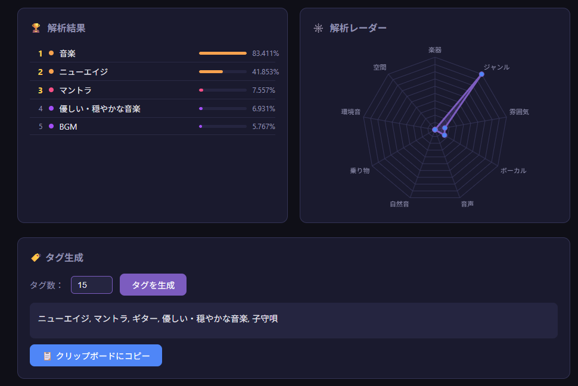
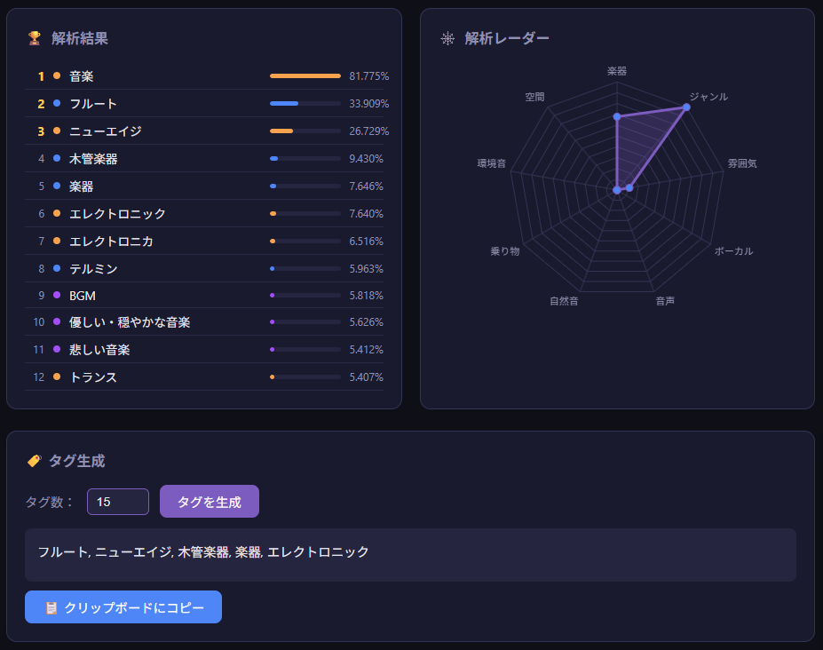
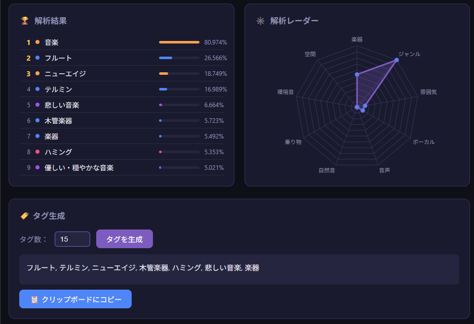
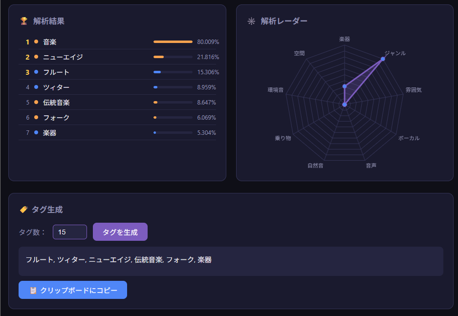
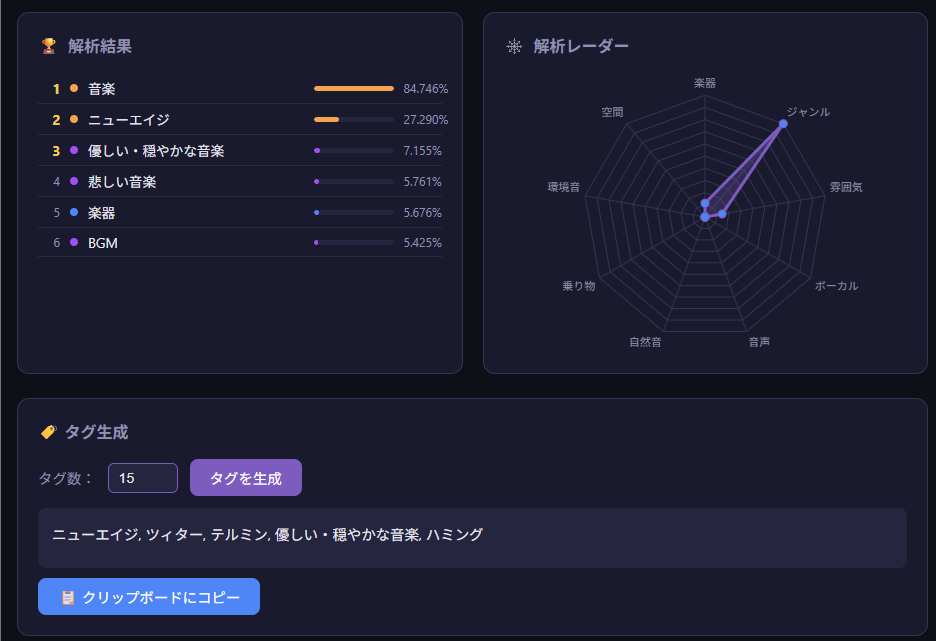
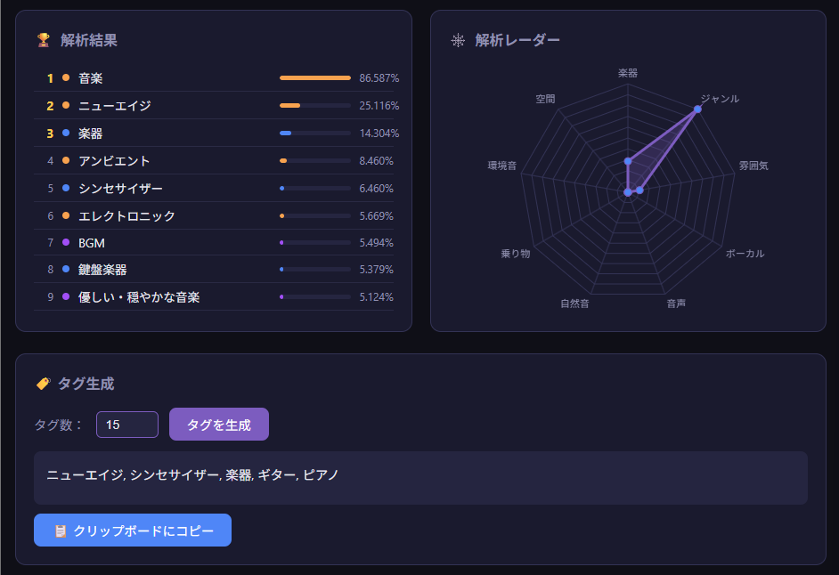
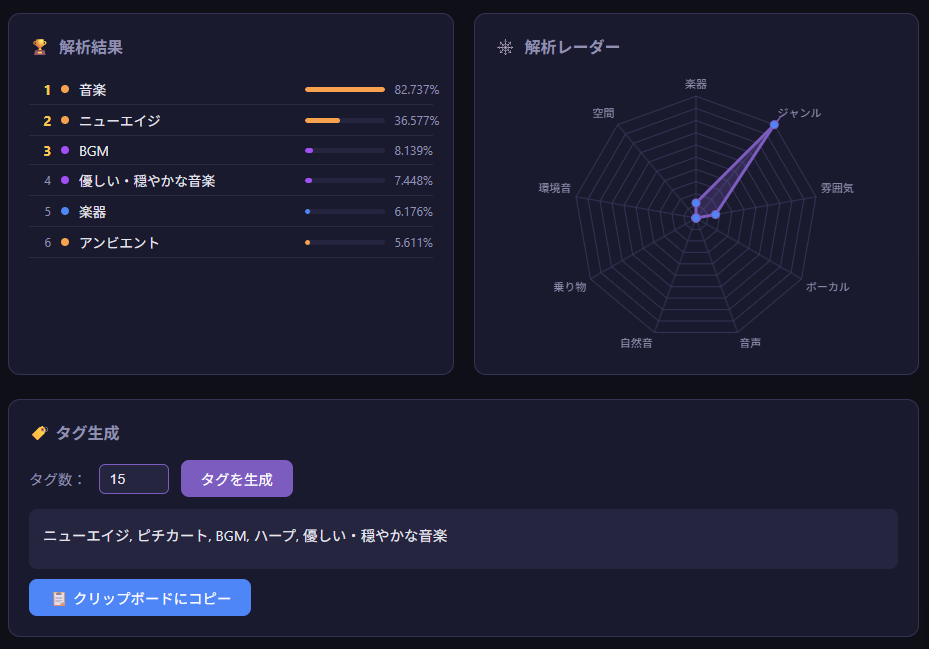
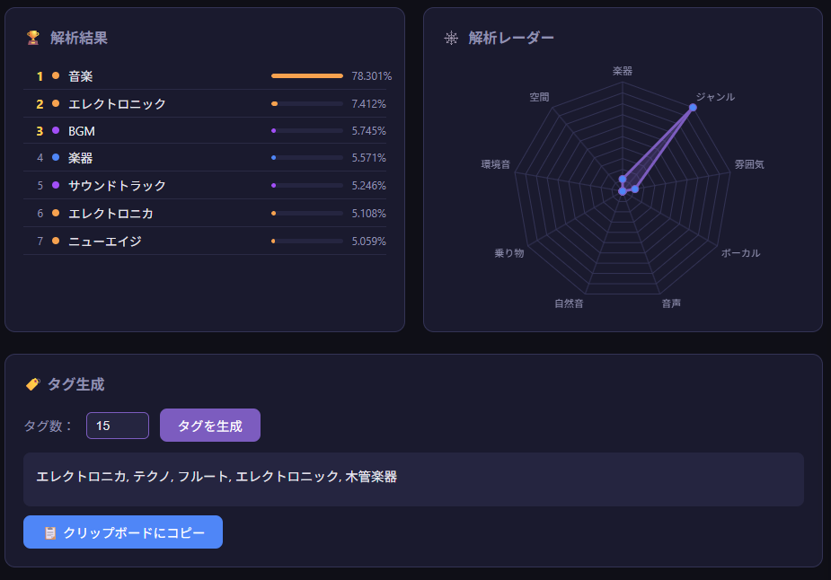

# スタイル指定の調査 (traditionalとstyle)

## 調査担当者

hirosof 


## 背景

以下2つのスタイルは、どちらも和風を示すスタイルではあるが、SUNOによる成果物では

何らかの差異が発生する可能性があるので確認する。

* Japanese traditional

* Japanese style


また、この調査で差異が確認できた場合、以下のように、Japanese以外でも同等に変化する可能性がありえると言える

* Chinese traditional

* Chinese style

  

## Geminiの見解

### 質問文 (僕からGeminiへの依頼文プロンプト)

```
音楽生成AIに以下を渡した時、どのような差異が発生しますか

* Japanese traditional 
* Japanese style

また、japaneseではなくChineseを指定した場合はどうなりますか。 
```

* 補足：Chineseの件はついでに確認しました

### Geminiからの回答 (そのままコードブロック内に記載します)

```markdown
音楽生成AI（Suno、Udio、MusicLMなど）において、プロンプトに指定する単語のニュアンスの違いは、学習データのタグ付けや関連付けられたメタデータによって明確な差となって現れます。

それぞれの指定によって生じる出力の傾向と差異を解説します。

---

### 1. `Japanese traditional` vs `Japanese style`

| 項目 | `Japanese traditional` (伝統) | `Japanese style` (和風・日本様式) |
| --- | --- | --- |
| **音楽的ジャンル** | 雅楽、神楽、能・狂言、民謡、邦楽古典 | 和風ポップス、和風ロック、Lo-Fi、アニメ・ゲームBGM |
| **主要な使用楽器** | 箏、尺八、三味線、和太鼓、篠笛、笙（しょう）などの**純邦楽器のみ**で構成されやすい | 箏や尺八の音色に加え、**シンセサイザー、エレキギター、ドラム、ピアノ**が混ざる |
| **音階・メロディ** | 陰旋法・陽旋法、呂律音階、微分音（ピッチの揺らぎ）など、**伝統的な日本音階**に厳密 | 西洋的なポップスコード進行の上に、ペンタトニック（ヨナ抜き音階など）を乗せた**現代的メロディ** |
| **リズム・ビート** | 「間（ま）」を重んじる非等拍（ルバート）や、手締め・太鼓のリズム | 4/4拍子などの明確な**グリッドに沿った現代的なビート** |
| **AIの解釈** | 「純粋な日本の古典音楽・民族音楽」 | 「西洋音楽や現代ビートに**和のエッセンスを加えたフュージョン**」 |

* **使い分けのコツ**:
* 寺社仏閣の厳かな雰囲気や古典芸能のような純粋な音を求めるときは `traditional`。
* アニメの戦闘曲や「和風Lo-Fi」「和風エレクトロニック」のような曲を作りたいときは `style`（または `modern Japanese style`, `Japanese style pop` など）が適しています。


---

### 2. `Japanese` を `Chinese` に変えた場合

`Chinese traditional` や `Chinese style` を指定した場合、使われる代表的な楽器、音階の響き、リズムのダイナミクスが中国音楽特有のものへ切り替わります。

#### 楽器の違い

* **和風 (Japanese)**: 箏（こと）、尺八、三味線、太鼓、篠笛
* 特徴：余白（間）が多く、鋭い撥弦（三味線）や息遣い（尺八）が目立ちます。


* **中華風 (Chinese)**: 二胡（Erhu）、古筝（Guzheng）、琵琶（Pipa）、笛子（Dizi）、揚琴（Yangqin）
* 特徴：二胡の伸びやかで哀愁ある擦弦音や、古筝・琵琶の細かいトレモロ（高速連打）、きらびやかなアルペジオが多用されます。


#### 旋律と雰囲気の違い

* **Chinese traditional**:
* 宮・商・角・徴・羽（チー・シャン・ジュエ・ジー・ユー）の**五声（ペンタトニック）音階**を基調とし、滑らかなグリッサンドや豊かなビブラートが特徴的です。日本の伝統音楽よりも**旋律線が連続的で歌うように流れる**傾向があります。


* **Chinese style**:
* 近年の中国ネット発祥の「国風（Guofeng）」音楽や、武侠・仙侠ドラマ（時代劇）、中国ソシャゲのBGMのようなスタイルになりやすいです。オーケストラやEDMのビートに二胡や古筝が華やかに絡む、ダイナミックで広がりのあるサウンドが生成されます。


---

### まとめ（指定時の選び方）

* **純粋な古典・民族楽器だけで構成したい場合**:
* `Japanese traditional music, Gagaku, Koto, Shakuhachi, meditative`
* `Chinese traditional music, Erhu, Guzheng, slow tempo, folk`


* **現代風のビートや親しみやすいメロディに混ぜたい場合**:
* `Japanese style modern rock, Shamisen melody, fast tempo`
* `Chinese style pop, Guofeng, emotional, Erhu, modern beat`


「どのようなシーン向けのBGMを作りたいか」や「狙っている具体的な楽器の組み合わせ」があれば、さらに精度を高めるタグの組み合わせをご提案できます。
```

## 作成条件

### ケースA

| 項目名         | 値                   | 備考                                         |
| -------------- | -------------------- | -------------------------------------------- |
| 歌詞           |                      | 空白指定                                     |
| スタイル       | Japanese traditional |                                              |
| 除外スタイル   |                      | 空白指定                                     |
| ボーカル性別   |                      | 選択なし                                     |
| 長さ           | Auto                 |                                              |
| Maxモード      | オフ                 |                                              |
| 奇抜さ         | 50%                  |                                              |
| スタイルの影響 | 50%                  |                                              |
| バリエーション | オフ                 | 指定したスタイルがそのまま使われるようにする |
| パーソナライズ | オフ                 |                                              |
| 曲名(任意)     |                      | 指定なし                                     |


### ケースB

| 項目名         | 値                   | 備考                                         |
| -------------- | -------------------- | -------------------------------------------- |
| 歌詞           |                      | 空白指定                                     |
| スタイル       | Japanese style |                                              |
| 除外スタイル   |                      | 空白指定                                     |
| ボーカル性別   |                      | 選択なし                                     |
| 長さ           | Auto                 |                                              |
| Maxモード      | オフ                 |                                              |
| 奇抜さ         | 50%                  |                                              |
| スタイルの影響 | 50%                  |                                              |
| バリエーション | オフ                 | 指定したスタイルがそのまま使われるようにする |
| パーソナライズ | オフ                 |                                              |
| 曲名(任意)     |                      | 指定なし                                     |


## 差異の確認方法

以下のツール( Audio AI Analyzer )が外部サーバーへの送信なく、
ブラウザ内で完結するらしいので、これを使って確認してみることにする

https://music-analysis.ullu-egg.com/analyzer.html

## 結果


### 基本情報

| ケース番号 | 曲名                        | 長さ(MM:SS) |
|--|--|--|
| A-1        | cherry blossoms in the rain | 2:53        |
| A-2        | cherry blossoms in the rain | 3:03        |
| A-3        | cherry blossoms in the rain | 3:12        |
| A-4        | cherry blossoms in the rain | 2:57        |
| B-1        | 桜の下で                    | 2:48        |
| B-2        | 桜の下で                    | 2:43        |
| B-3        | 桜の季節                    | 3:04        |
| B-4        | 桜の季節                    | 3:12        |


###  Audio AI Analyzer の使用結果

#### A-1



#### A-2



#### A-3



#### A-4



#### B-1




#### B-2




#### B-3



#### B-4




